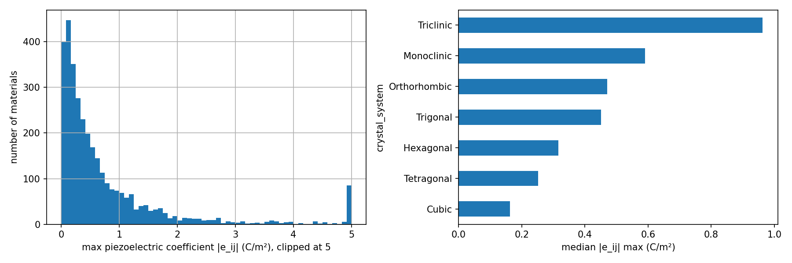
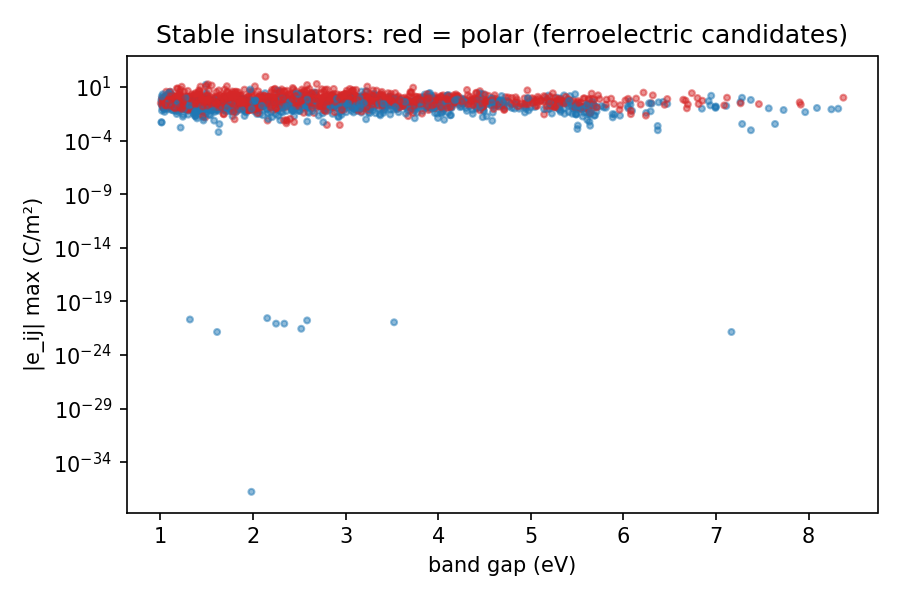

# Piezoelectric Materials Explorer — Materials Project data analysis

**Which materials have the strongest piezoelectric response, and what do they have in common?**

Data analysis of **3,316 materials** with DFT-computed piezoelectric tensors from the
[Materials Project](https://next-gen.materialsproject.org/), using Python (pandas, matplotlib).

Author: **Oussama Azaroual**, PhD in physics (ferroelectric thin films), data analyst.

---

## Key results

| | |
|---|---|
| Materials analysed | 3,316 |
| Stable insulators (band gap ≥ 1 eV, ≤ 50 meV/atom above hull) | 1,903 |
| Median max coefficient, **polar** materials | **0.60 C/m²** |
| Median max coefficient, non-polar materials | 0.19 C/m² |
| Suspicious values flagged (> 30 C/m²) | 9 (0.3 %) |

1. **Polar materials (ferroelectric candidates) are about 3× more piezoelectric** than non-polar ones.
2. **Lower crystal symmetry → larger maximum coefficient** (triclinic > monoclinic > … > cubic).
3. **Promising lead-free candidates** among stable insulators: ScBiO3, BaNiO3, WO3, NaBiS2, LaWN3 (7–19 C/m²).

## Validation against experiment (orders of magnitude)

| Material | DFT (C/m²) | Experiment (≈, C/m²) |
|---|---|---|
| α-quartz SiO2 | 0.19 | 0.17 |
| ZnO (wurtzite) | 1.29 | 1.3 |
| AlN | 1.68 | 1.5 |
| GaN | 0.62 | 0.7 |
| BaTiO3 (Amm2) | 4.2 | 6.7 (tetragonal phase) |

Excellent agreement for well-known piezoelectrics. BaTiO3 is computed in its low-temperature
orthorhombic phase, which explains the lower value.

## Data quality

- 9 values above 30 C/m² were flagged: one metal (NbAs, band gap 0 — a metal cannot be piezoelectric),
  unstable hypothetical structures (0.08–0.32 eV/atom above hull), and a P1 supercell of the relaxor PMN.
- Removing them does not change the conclusions (median 0.600 → 0.597 C/m²).

## Limits

- DFT values at 0 K for perfect single crystals; real ceramics and thin films show lower coefficients.
- Only ~3,300 materials have a computed tensor — PbTiO3, for example, is missing: a natural extension.

## How to run

1. Create a free account at materialsproject.org and copy your API key.
2. Open `piezo_materials_project.ipynb` in Google Colab.
3. Paste your key in Step 2 and run all cells.

## Files

| File | Content |
|---|---|
| `piezo_materials_project.ipynb` | Full notebook (download, cleaning, analysis, conclusions) |
| `piezo_materials_clean.csv` | Cleaned dataset (3,316 rows) |
| `fig1_distribution.png` | Distribution of coefficients and median by crystal system |
| `fig2_gap_vs_piezo.png` | Band gap vs coefficient, polar vs non-polar |

Data: Materials Project (CC BY 4.0). Cite: Jain et al., *APL Materials* 1, 011002 (2013);
de Jong et al., *Scientific Data* 2, 150053 (2015) for the piezoelectric dataset.
